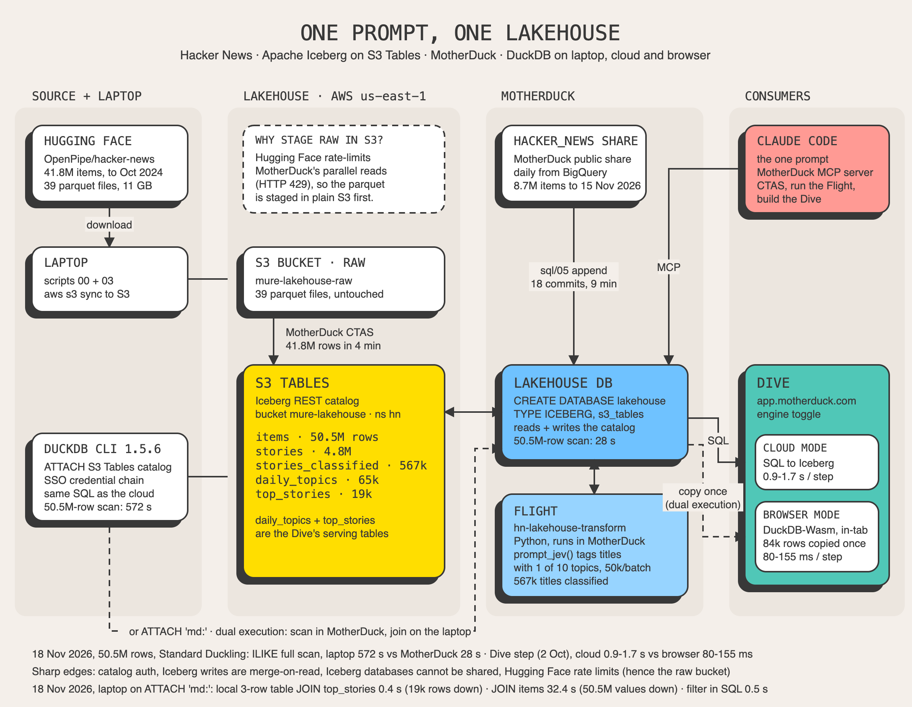
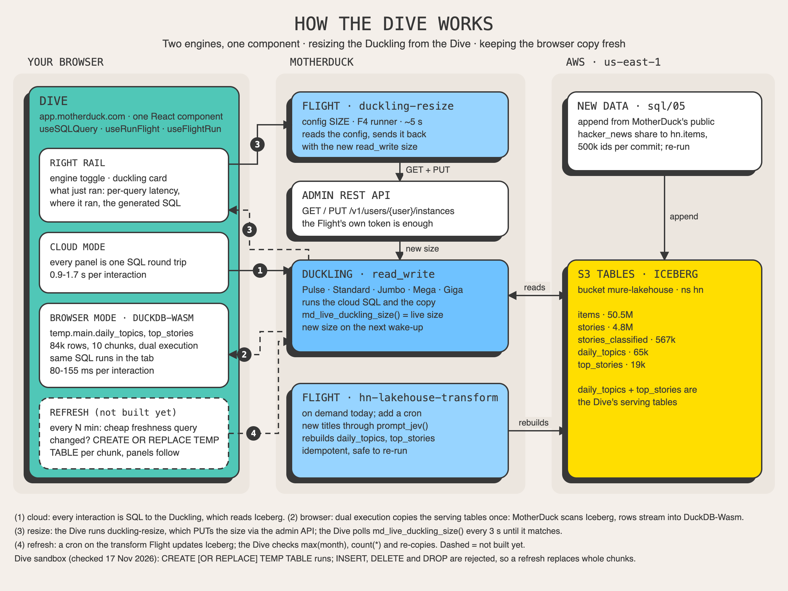

# One Prompt, One Lakehouse

Code and SQL from the talk **"One Prompt, One Lakehouse"** at Mure Forward #2 (DuckDB + Iceberg,
19 Nov 2026).

An agent (Claude Code with the MotherDuck MCP server and the AWS CLI) lands Hacker News in
**Apache Iceberg on Amazon S3 Tables**, enriches it with **`prompt_jev()`** in **MotherDuck**, and
serves it in a **Dive**. The same Iceberg tables are then queried from three places: MotherDuck in
the cloud, plain DuckDB on a laptop, and DuckDB-Wasm in the browser.



## What's in the repo

| Path | What |
|---|---|
| [`sql/00_quickstart.sql`](sql/00_quickstart.sql) | Iceberg in MotherDuck in three statements |
| [`scripts/`](scripts) | AWS setup (S3 Tables bucket, raw bucket, IAM user), MotherDuck connection, the initial load |
| [`sql/`](sql) | the append from MotherDuck's `hacker_news` share, the model and enrichment steps, laptop vs cloud queries |
| [`flights/hn_transform.py`](flights/hn_transform.py) | the transformation Flight: stories, `prompt_jev()` topics, serving tables |
| [`flights/duckling_resize.py`](flights/duckling_resize.py) | a Flight that resizes your Duckling, called from the Dive |
| [`dive/dive.tsx`](dive/dive.tsx) | the Dive: one React component, cloud and DuckDB-Wasm engines |
| [`.dive-preview/`](.dive-preview) | a small Vite harness to run the Dive locally |
| [`prompts/`](prompts) | the prompt that rebuilds the whole stack, and the one-shot prompt for motherduck.com/try |
| [`docs/`](docs) | architecture and Dive diagrams (Excalidraw and SVG sources) |

The data itself is not in the repo. `scripts/00` downloads it.

## Quickstart: Iceberg in MotherDuck in three statements

If you already have an S3 table bucket and an AWS key that can read it, this is the whole
MotherDuck side ([`sql/00_quickstart.sql`](sql/00_quickstart.sql) is the commented version):

```sql
CREATE SECRET s3t IN MOTHERDUCK (TYPE S3, KEY_ID '…', SECRET '…', REGION 'us-east-1');

CREATE DATABASE lakehouse (
    TYPE ICEBERG,
    endpoint_type 's3_tables',
    warehouse 'arn:aws:s3tables:us-east-1:<account-id>:bucket/<your-table-bucket>',
    "secret" s3t,
    default_schema 'hn'
);

SELECT topic, count(*) AS stories
FROM lakehouse.hn.stories_classified
GROUP BY topic;
```

`CREATE DATABASE … TYPE ICEBERG` copies nothing. It registers the existing catalog, and
`DROP DATABASE` only removes that registration. Glue (`endpoint_type 'glue'`) and other Iceberg REST
catalogs use the same two statements with different options.

## Build it from scratch

| Step | Run | Where | What it does |
|---|---|---|---|
| 0 | `scripts/00_download_hn_raw.sh` | laptop | downloads the 39 Parquet files of [`OpenPipe/hacker-news`](https://huggingface.co/datasets/OpenPipe/hacker-news) (about 11 GB, items to Oct 2024), resumable |
| 1 | `AWS_PROFILE=… scripts/01_aws_s3tables_setup.sh` | AWS | S3 Tables bucket and namespace `hn`, plus a plain S3 bucket for the raw files |
| 1b | `AWS_PROFILE=… scripts/01b_aws_iam_user.sh` | AWS | an IAM user scoped to those two buckets. Flights and Dives run unattended, so they need a key that outlives an SSO session |
| 2 | `scripts/02_motherduck_connect.sh` | AWS + MotherDuck | mints an access key and runs `CREATE SECRET … IN MOTHERDUCK` and `CREATE DATABASE lakehouse (TYPE ICEBERG, …)`. The key never touches disk |
| 3 | `scripts/03_load_hn_to_iceberg.sh` | laptop → S3, then MotherDuck | `aws s3 sync` of the raw files, then one CTAS into `lakehouse.hn.items` (41.8M rows in about 4 minutes) |
| 3b | `sql/05_append_from_md_share.sql` | MotherDuck | appends newer items from MotherDuck's public `hacker_news` share, 500K ids per Iceberg commit; re-run until it inserts 0 rows |
| 4 | Flight `hn-lakehouse-transform` (`flights/hn_transform.py`) | MotherDuck Flights | rebuilds `stories`, classifies new titles with `prompt_jev()` in 50K batches, rebuilds the serving tables `daily_topics` and `top_stories`. Idempotent; run on demand or on a cron. `sql/10` and `sql/20` are the manual equivalent |
| 5 | Flight `duckling-resize` (`flights/duckling_resize.py`) | MotherDuck Flights | optional: lets the Dive resize your Duckling. Put its id in `RESIZE_FLIGHT_ID` in `dive/dive.tsx` |
| 6 | Dive (`dive/dive.tsx`) | MotherDuck | create it with the `motherduck` CLI (`motherduck dive push`) or the MotherDuck MCP server |
| 7 | `sql/30_laptop_duckdb.sql` and `sql/31_motherduck_same_queries.sql` | laptop vs cloud | the same queries from a laptop straight on S3 Tables and on MotherDuck |

Credentials: put `MOTHERDUCK_TOKEN=…` in `.env` (see `.env.example`; `.env` is gitignored). The scripts
read it from there.

Or hand the whole job to an agent: [`prompts/build_lakehouse.md`](prompts/build_lakehouse.md) is one
prompt that covers steps 1–6. It is a reconstruction of several working sessions and has not been run
end to end in one go.

Tables in `lakehouse.hn` after the build (data through 15 Nov 2026):

| Table | Rows | Parquet | Built by |
|---|---|---|---|
| `items` | 50.5M | 6.6 GiB in 14 files | CTAS from the raw files, then the append from the share |
| `stories` | 4.8M | 301 MiB | Flight: live stories only, plus domain, year, month |
| `stories_classified` | 567K | 37 MiB | Flight: stories with 20+ points, plus `topic` and `confidence` from `prompt_jev()` |
| `daily_topics` | 65K | 1.2 MiB | Flight: day × topic, the Dive's main serving table |
| `top_stories` | 19K | 1.1 MiB | Flight: top 100 stories per year and topic |

## How the Dive works



**Two engines, one component.** Every panel builds its SQL against a table prefix:
`"lakehouse"."hn"` in cloud mode, `"temp"."main"` in browser mode. Nothing else changes.

- **Cloud mode.** Each interaction sends the panels' SQL to your Duckling, which reads the two
  serving tables (84K rows, about 2 MB of Parquet) from S3 Tables. An interaction takes about a
  second. The queries are small; most of the time is a per-query Iceberg catalog check (about
  0.17 s) and the round trip, and an interaction's four or five queries finish one after another.
- **Browser mode.** Switching engines copies the two serving tables into DuckDB-Wasm temp tables in
  10 statements. Each copy is a dual-execution query: MotherDuck scans Iceberg and the rows stream
  into the tab. After the copy (about 4 s), every click runs in the browser in about 0.1 s. The copy
  is a snapshot: a new Iceberg commit means copying again.
- **The "what just ran" pane** sits behind a tab on the right edge (click to open, `P` to pin). It
  shows the engine toggle, the Duckling size, and every query of the last interaction: where it
  ran (`motherduck`, `cloud → browser`, `browser`), its latency and its SQL.

To run it locally, put `VITE_MOTHERDUCK_TOKEN=…` in `.dive-preview/.env`, then
`cd .dive-preview && npm install && npx vite`. The harness copies `dive/dive.tsx` as `src/dive.tsx`;
keep the two in sync.

## Dual execution on Iceberg

Any DuckDB that attaches `md:` (the CLI, Python, or the DuckDB-Wasm inside a Dive) plans each query
once and runs each operator either locally or in MotherDuck. On an Iceberg database the scan always
runs in MotherDuck, where the catalog secret is and the bucket is close. Measured 18 Nov 2026 from a
laptop (DuckDB 1.5.6, `ATTACH 'md:'`):

| Query | What the planner did | Time |
|---|---|---|
| 3-row local table `JOIN lakehouse.hn.top_stories USING (domain)` | Iceberg scan in MotherDuck (1 file, `domain` only), 19,476 values down, join on the laptop | 0.4 s |
| 3-row local table `JOIN lakehouse.hn.items ON "by" = username` | Iceberg scan in MotherDuck, then all 50.5M `by` values (125 MiB) down, join on the laptop | 32.4 s |
| Same lookup as `WHERE "by" IN ('pg', 'dang', 'tptacek')` | filter and count in MotherDuck, 3 rows down | 0.5 s* |
| 3-row table in MotherDuck `JOIN lakehouse.hn.items` | whole join in MotherDuck, 3 rows down | 1.5 s* |

\* Ran right after the 32 s join, with the `by` column cached. Cold, they took 1.3 s and 4.3 s.

The planner brings the big side down; it does not push a small local table up. With a big Iceberg
table, filter in SQL, aggregate before rows cross, or put the small table in MotherDuck first.
`EXPLAIN ANALYZE` shows the split as a `HYBRID_RUNNER` with `DOWNLOAD_SOURCE` / `DOWNLOAD_SINK` pairs
where rows cross.

## Same tables, three places

Measured 18 Nov 2026. Laptop in Croatia running DuckDB 1.5.6 straight on S3 Tables; MotherDuck on a
Standard Duckling in us-east-1, queried from the same laptop.

| Query | Laptop | MotherDuck | Browser (DuckDB-Wasm) |
|---|---|---|---|
| Full scan: `ILIKE '%duckdb%'` on title and text of `items` (50.5M rows, 6.1 GiB read) | 572 s | 28 s | not copied |
| Dive panel: monthly trend on `daily_topics` (65K rows) | 2.4 s first, 0.17 s repeat | 0.34 s on an open connection | about 0.1 s per click after the copy |

Big scans belong next to the bucket. Small serving tables run fine anywhere, and the browser wins on
interaction because nothing crosses the network. Opening a new MotherDuck connection adds about
0.5–0.8 s to its first query; the numbers above exclude it.

What DuckDB reads on Iceberg (`EXPLAIN ANALYZE` on MotherDuck, first runs): an id filter newer than any
row reads 0 of 14 files; a filter on the newest ids reads 1 of 14; `count(*), sum(score)` reads 12 MiB
for 50.5M rows; the full `ILIKE` reads 6.1 GiB. Bytes follow the columns you touch and the files the
manifest statistics can't rule out, not the row count.

## Keeping the data fresh

1. **New items.** Run [`sql/05_append_from_md_share.sql`](sql/05_append_from_md_share.sql) until it
   inserts 0 rows. MotherDuck's public `hacker_news` share is refreshed daily from Google's BigQuery
   copy of Hacker News. Each run appends the next 500K ids after `max(id)` as one Iceberg commit, so a
   stopped run leaves no gaps or duplicates. The share has no `top_level_parent`; the statement
   computes it.
2. **Serving tables.** Give the `hn-lakehouse-transform` Flight a cron schedule. It only classifies
   titles that aren't classified yet, so `prompt_jev()` cost follows the new rows.
3. **Browser copy.** Not built. The copy lives until the page reloads. A refresh would poll a cheap
   signature (for example `max(month)` and `count(*)` of `daily_topics`) every few minutes and
   re-copy with `CREATE OR REPLACE TEMP TABLE` when it changes. The Dive sandbox allows
   `CREATE [OR REPLACE] TEMP TABLE` but rejects `INSERT`, `DELETE` and `DROP` on temp tables.

## Sharp edges

- **Catalog auth.** Flights and Dives run without you, so they need a credential that outlives an SSO
  session. This project uses one IAM user scoped to the table bucket and the raw bucket.
- **Write semantics.** Iceberg in MotherDuck has no `CREATE OR REPLACE`, and deletes are
  merge-on-read. Rebuilds are `DROP` then `CREATE`; appends go in batches. An open Dive briefly errors
  while the Flight drops and re-creates a serving table.
- **Sharing.** An Iceberg database in MotherDuck can't be shared like a native one. Each account
  attaches the catalog itself; to share the Dive, also write the serving tables to a regular
  MotherDuck database and share that.
- **Source limits.** Hugging Face throttled 39 parallel reads from the cloud (HTTP 429), so the raw
  files are staged in S3 first.
- **Compaction.** S3 Tables compacts small files automatically. Replaced files stay in the manifest
  list as `DELETED` entries, so filter `iceberg_metadata()` on `status` when you count files.
- **`duckling-resize`** always resizes the Flight owner's Duckling, whoever clicks. Don't grant `RUN`
  on it to anyone you don't want resizing (and paying for) your Duckling.

## Data

Hacker News items from the [`OpenPipe/hacker-news`](https://huggingface.co/datasets/OpenPipe/hacker-news)
dataset on Hugging Face (to Oct 2024) and MotherDuck's public `hacker_news` share (after that). Hacker
News content belongs to its authors; this repo contains no data, only the code that loads it.
